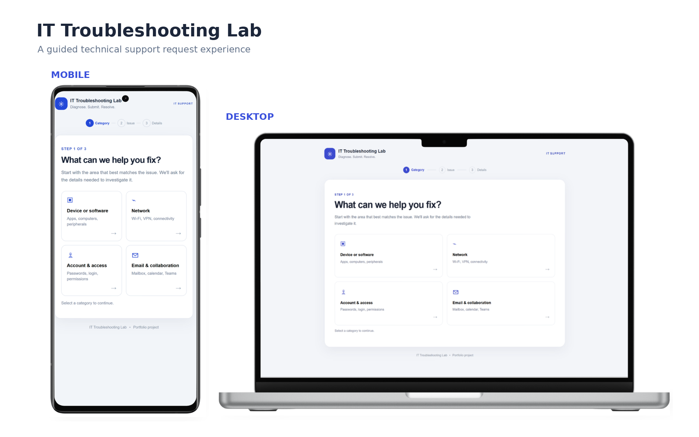

# IT Troubleshooting Lab

### A smarter way to manage IT support requests.

IT Troubleshooting Lab is a web-based IT support platform designed to help users identify and resolve common technical problems. The goal is to provide guided troubleshooting, AI-assisted recommendations, and access to professional IT support when additional help is needed.

## Application Preview

A responsive support experience designed for desktop and mobile devices.



## Current Features

- Guided three-step support request workflow.
- Four support categories: Device or Software, Network, Account and Access, and Email and Collaboration.
- Dynamic issue selection based on the selected category.
- Server-side form validation and submission confirmation.
- Responsive desktop and mobile interface.

## Technologies

Python · Flask · HTML · CSS · JavaScript · Git · GitHub

## Run Locally

**Prerequisites:** Python 3 and Git.

**1. Clone the repository**

```bash
git clone https://github.com/ChrisThatGamer1/it-troubleshooting-lab.git
cd it-troubleshooting-lab
```

**2. Create a virtual environment**

```bash
python -m venv .venv
```

**3. Activate the virtual environment**

Windows PowerShell:

```powershell
.\.venv\Scripts\Activate.ps1
```

macOS / Linux:

```bash
source .venv/bin/activate
```

**4. Install dependencies**

```bash
pip install -r requirements.txt
```

**5. Start the application**

```bash
python app.py
```

Open http://127.0.0.1:5000 in your browser.
