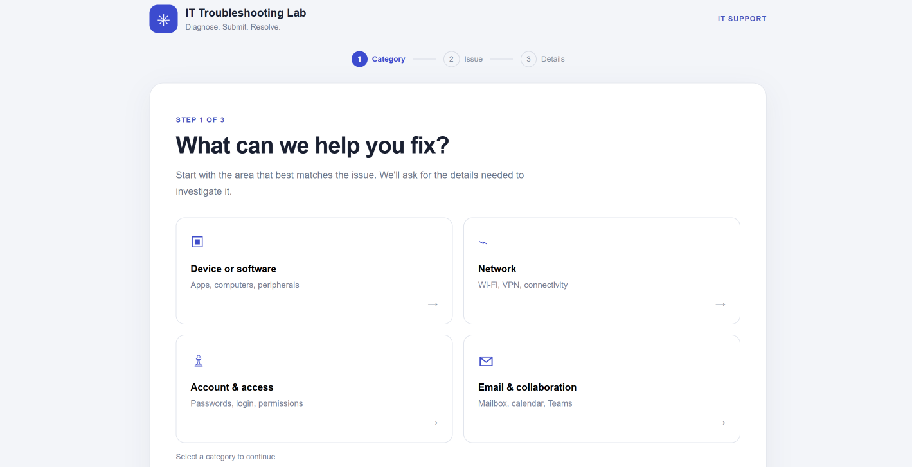

# IT Troubleshooting Lab

### A smarter way to manage IT support requests.

IT Troubleshooting Lab is a web-based application that guides employees through submitting technical support requests. Users select an issue category, identify the specific problem, and provide details to help an IT technician understand what needs to be investigated.

The project is being developed with Python and Flask, alongside HTML, CSS, and JavaScript.

## Application Preview

The application features a guided, three-step issue submission workflow with a responsive interface for desktop and mobile devices.

### Desktop Experience



### Mobile Experience


## Current Features

- Guided three-step issue submission workflow.
- Four issue categories:
  - Device or software
  - Network
  - Account and access
  - Email and collaboration
- Dynamic issue-type selection based on the chosen category.
- Technical issue description form.
- Server-side validation using Flask.
- Submission confirmation displaying the submitted issue details.
- Responsive interface for desktop and mobile devices.

## Technologies

- **Python** – Application logic
- **Flask** – Web framework and server-side request handling
- **HTML** – Application structure
- **CSS** – Styling and responsive layout
- **JavaScript** – Interactive issue-selection workflow
- **Git and GitHub** – Version control and source code management

## Running Locally

### 1. Clone the repository

```bash
git clone https://github.com/ChrisThatGamer1/it-troubleshooting-lab.git
cd it-troubleshooting-lab
```

### 2. Create a virtual environment

```bash
python -m venv venv
```

### 3. Activate the virtual environment

**Windows (PowerShell):**

```powershell
.\venv\Scripts\Activate.ps1
```

**macOS / Linux:**

```bash
source venv/bin/activate
```

### 4. Install dependencies

```bash
pip install -r requirements.txt
```

### 5. Start the application

```bash
python app.py
```

### 6. Open the application

Visit the following address in your browser:

```text
http://127.0.0.1:5000
```

## Project Status

**In development.**

The current version focuses on the employee-facing issue submission experience. Future development will expand the application with additional troubleshooting guidance, persistent request storage, and tools for IT technicians to review and manage submitted requests.# IT Troubleshooting Lab

### A smarter way to manage IT support requests. 

A web-based IT service desk application designed to help employees submit technical issues and give IT technicians a centralized platform to manage, investigate, and resolve spport requests. 

### Application Preview

The employee-facing support portal features a guided issue submission workflow with a responsive interface designed for desktop and mobile devices.

### Desktop Experience


### Mobile Experience


## Current Features

- Basic Flask web application
- Homepage route
- Local development server

## Technologies

- Python
- HTML & CSS
- JavaScript
- Flask
- Git and GitHub

## Running Locally

1. Clone the repository.
2. Create and activate a Python virtual environment.
3. Install Flask.
4. Run the application with `python app.py`.
5. Open `http://127.0.0.1:5000` in your browser.

## Project Status

In development. I'm building this project incrementally as I learn and add new features.
