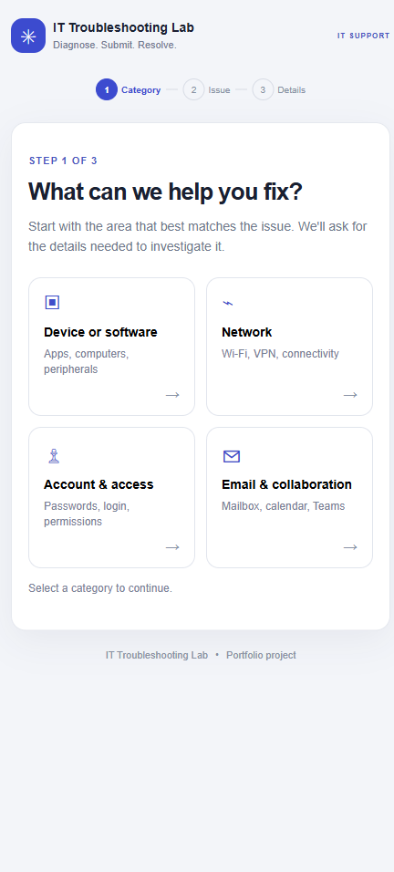

# IT Troubleshooting Lab

### A smarter way to manage IT support requests. 

A web-based IT service desk application designed to help employees submit technical issues and give IT technicians a centralized platform to manage, investigate, and resolve spport requests. 

### Application Preview

The employee-facing support portal features a guided issue submission workflow with a responsive interface designed for desktop and mobile devices.

### Desktop Experience

### Mobile Experience

## Current Features

- Basic Flask web application
- Homepage route
- Local development server

## Technologies

- Python
- HTML & CSS
- JavaScript
- Flask
- Git and GitHub

## Running Locally

1. Clone the repository.
2. Create and activate a Python virtual environment.
3. Install Flask.
4. Run the application with `python app.py`.
5. Open `http://127.0.0.1:5000` in your browser.

## Project Status

In development. I'm building this project incrementally as I learn and add new features.
